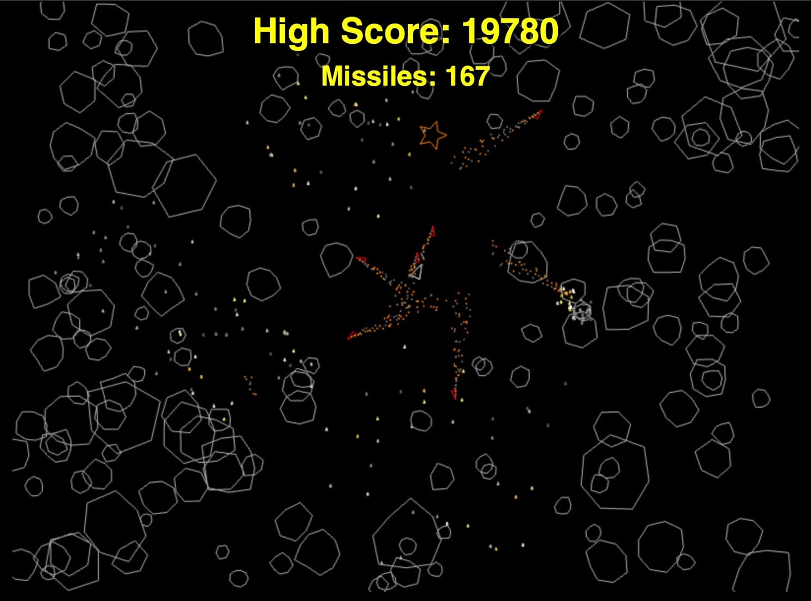

## 🛸 AsterBlaster: Full-Code LLM Experiment

<table>
  <tr>
    <td width="40%">
      
    </td>
    <td width="60%" valign="top">
      <h4>🤖 The Context Limit Experiment (2024)</h4>
      
A pure AI research experiment designed to test the absolute boundaries of LLM software engineering. The model successfully generated a complete WebGL shooting game from scratch, including all custom retro sound effects and music procedural generation routines.

      
<b>⚠️ Token Threshold Note:</b> This codebase maps the precise boundary of the LLM's context limit. Attempting to expand the feature set further triggered code omissions, structural regressions, and logic breaks.

      <a href="https://brightland.com/games/asterblaster/"><b>🕹️ Launch Live Demo</b></a>
    </td>
  </tr>
</table>
